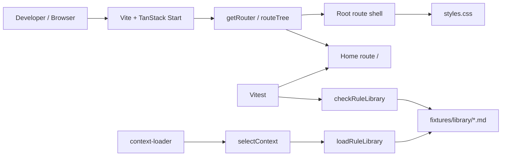
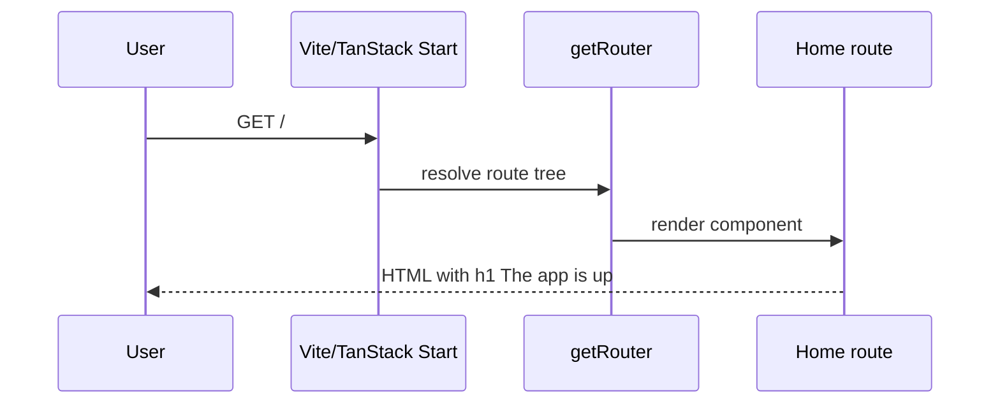
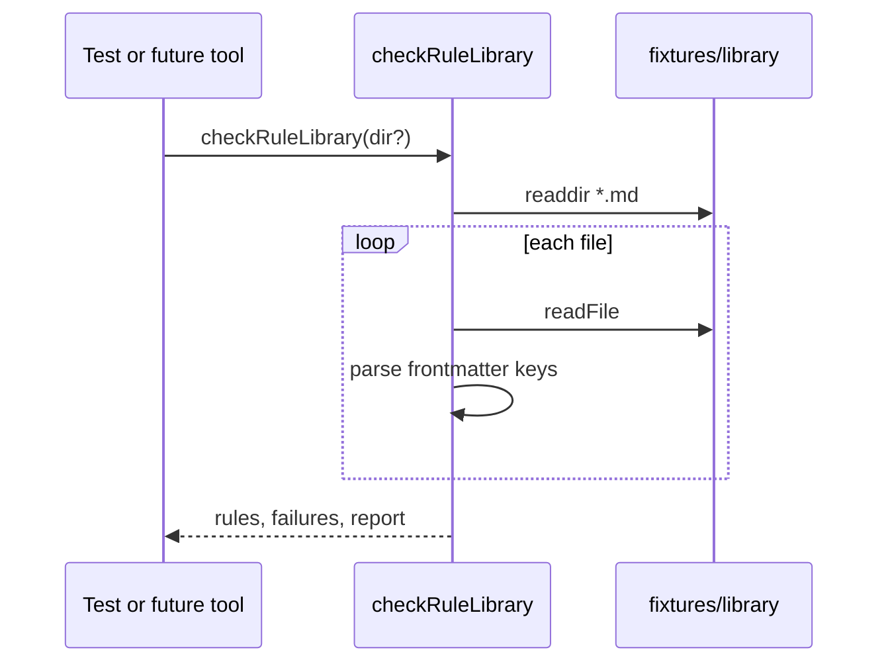
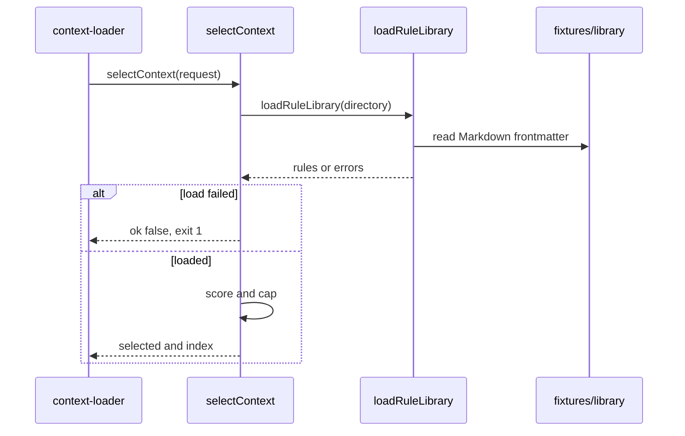

# Architecture

## Architecture Analysis

### System Overview

A single-package TanStack Start (Vite + React) app with file-based routing and SSR registration. Application UI is minimal: one root document shell and one `/` home route. Domain-adjacent logic for the rule library lives in `src/lib/rule-check.ts`, which reads Markdown files from `fixtures/library/` on the filesystem (prior scan; `src/` not re-opened). A separate Node CLI under `tools/` loads the same fixture directory, scores rules, and prints JSON. There is no separate API service, database, or message bus. `tools/` does not import `src/`.

### Architectural Style

**Modular monolith / local full-stack SPA+SSR, plus a local CLI** — one Node/Vite process for the app, and a direct-run TypeScript CLI for rule selection. Evidence for the app remains the prior scan (`package.json` scripts, `@tanstack/react-start` Vite plugin, single `src/` tree). Evidence for the CLI is `tools/context-loader.ts` calling `selectContext` and `loadRuleLibrary`.

### Component Relationships

Text fallback: Developer/browser hits Vite+TanStack Start, which uses the generated route tree to render the root shell and home route (with CSS). Vitest exercises the home component and `checkRuleLibrary`, which reads Markdown rule files from `fixtures/library/`. The CLI calls `selectContext`, which calls `loadRuleLibrary` on that same directory. No production page path was re-checked this run.

### Data Flow

1. **Page render** (prior scan, `src/` not re-opened): request → TanStack router → `__root` document + `index` component → static heading HTML (no fetch).
2. **Rule validation** (prior scan): caller supplies (or defaults) a library directory → list `*.md` → parse frontmatter for required keys → return rules, failures, and a human report string.
3. **Context loader** (this run): CLI args → `selectContext` → `loadRuleLibrary` → score and cap → JSON on stdout, warnings on stderr. Contract: `api-documentation.md`.

### Key Design Decisions

- **File-router layout** (prior scan): routes under `src/routes/`; generated `routeTree.gen.ts` must not be hand-edited.
- **Path aliases** (prior scan): `#/*` and `@/*` → `./src/*`.
- **Library decoupled from UI** (prior scan): home page does not call `checkRuleLibrary`. This run: `tools/` does not import `src/`.
- **Frontmatter contract**: required keys `tags`, `applicable_stages`, `applicable_agents`. The tools reader uses the values for scoring; see `api-documentation.md`. Parity with `src/lib/rule-check.ts` was not re-checked.
- **Selection policy**: stage, agent, and tags are optional filters; the selector returns a bounded list plus warnings. Details in `api-documentation.md`.
- **Package manager** (prior scan): pnpm; Vite/TanStack scaffold via `.cta.json`.

### Improvement Opportunities

- `tools/rule-library.ts` and `src/lib/rule-check.ts` (not re-opened) are separate frontmatter readers. Sharing one parser would remove drift risk.
- The CLI size check warns and still prints. See `api-documentation.md`.
- CI was absent on the prior scan and was not re-opened.

## Interaction Diagrams

### Home page render

Text fallback: User requests `/`; Vite/TanStack resolves the route tree; Home renders the heading; no library or network I/O. Prior scan; routes not re-opened.

### Rule library validation

Text fallback: Caller invokes `checkRuleLibrary`; it lists and reads Markdown files, checks required frontmatter keys, and returns structured rules/failures plus a report string. Prior scan; `src/lib/rule-check.ts` not re-opened.

### Context loader selection

Text fallback: The CLI calls selectContext, which loads the rule library from disk. Load errors come back as exit 1. A successful load is scored and capped, then returned as selected rules plus an index. Stdout and stderr handling is in `api-documentation.md`.
