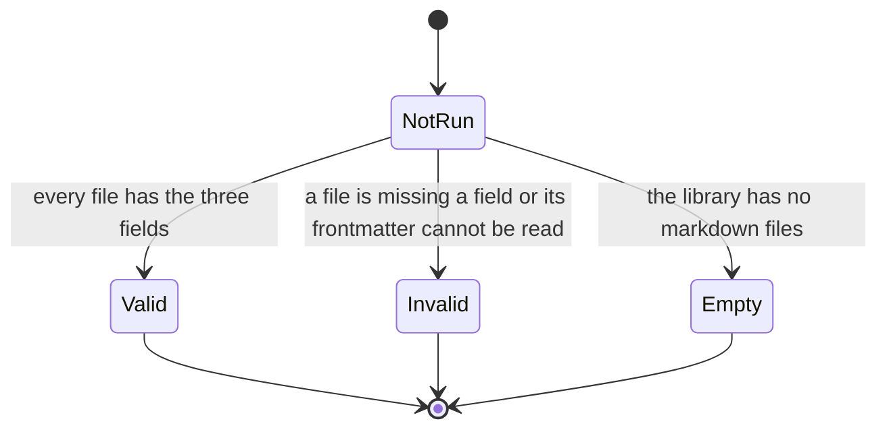
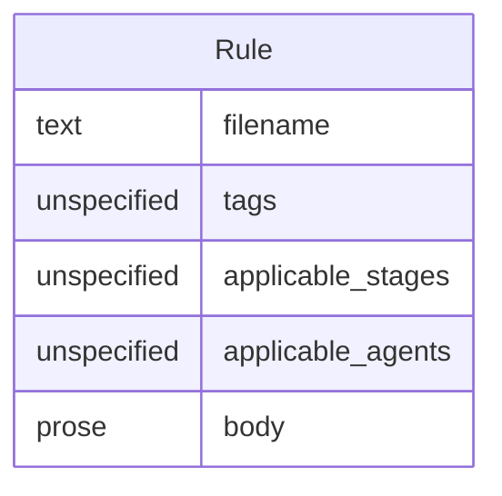

# Functional Spec — u1-skeleton

Stories this unit implements: US1.1, US1.2, US1.3, US2.1, US2.2, US2.3, US2.4, US2.5, US2.6, US2.7, US2.8, US2.9, US3.1, US3.2, US3.3, US4.1, US4.2, US4.3, US5.1, US5.2.

This file is the source of truth for workflows and state. The entity diagram and the rules table below are derived from `entities.md` and `rules.md`.

## Workflow — open the home page

Stories: US1.1, US1.2, US1.3, US5.1, US5.2. Rules: BR1.1, BR1.2, BR1.3, BR1.4.

1. The person builds the application on their machine. The build finishes. A second build also finishes.
2. The person starts the application on their machine. No staging host, preview URL, or production host is required, and this phase has no deploy step.
3. The person opens the home route. There is no sign-in step, and the page does not wait on a remote API.
4. The page shows one heading, "The app is up", inside the main region. The browser tab uses the same sentence.
5. The page shows no gameplay, account, score, saved progress, navigation, button, image, or rule list.

The page has one state: shown. It has no loading state and no error state, because it does not fetch data.

## Workflow — check the rule files

Stories: US2.1, US2.2, US2.3, US2.4, US2.5, US2.6, US2.7, US2.8, US2.9, US3.1, US3.2, US3.3, US4.1, US4.2, US4.3. Rules: BR2.1, BR2.2, BR2.3, BR2.4, BR2.5, BR2.6, BR2.7, BR2.8, BR2.9, BR3.1, BR3.2, BR4.1.

1. The skeleton includes five markdown files under `fixtures/library`: `app-structure.md`, `routing.md`, `server-data.md`, `styling.md`, and `testing.md`. Each states its approved one-line rule, why it exists, and a short example.
2. The person runs the check. It reads every markdown file under `fixtures/library`. A markdown file anywhere else is not a rule.
3. For each file, the filename is the identity. The check looks for `tags`, `applicable_stages`, and `applicable_agents`.
4. When all three fields are present, the file is a valid rule. The value kinds of those fields stay unspecified.
5. When a required field is missing, the check fails, names the file and the missing field, and does not count that file as a rule. Any valid file in the same folder is still reported as valid.
6. When the frontmatter cannot be read, the check fails, names the file and that the frontmatter is unreadable, and does not count that file as a rule.
7. When `fixtures/library` contains no markdown files, the check reports that there are no rule files. That report is not a failed parse. The home page still responds.
8. The home page does not show the check result. HomeApp and RuleLibrary do not call each other.
9. Tests for the missing field, the empty library, and the responding home route are written after the code they cover. The project's test command runs them.

## Check outcomes

Text fallback: the check starts not run. It ends as valid, invalid, or empty. Empty is not a failure. Invalid names the file and the fault. The home page stays in its single shown state through all three outcomes.

## Entity view

Derived from `entities.md`.

Text fallback: Rule stands alone. It has filename, tags, applicable_stages, applicable_agents, and body. There is no relationship to another entity.

## Rules summary

Derived from `rules.md`.

| Rule | Statement |
| --- | --- |
| BR1.1 | The application builds and starts locally. |
| BR1.2 | The home route shows "The app is up" and no game content. |
| BR1.3 | No sign-in and no remote wait. |
| BR1.4 | This phase does not deploy. |
| BR2.1 | Filename under `fixtures/library` is the rule identity. |
| BR2.2 | Five starter files. |
| BR2.3 | Three frontmatter fields must be present. |
| BR2.4 | Body is prose with rule, reason, and example. |
| BR2.5 | No second top-level source tree. |
| BR2.6 | Each screen is a route. This phase has the home page only. |
| BR2.7 | Server functions for server-only data. The home page fetches nothing. |
| BR2.8 | One styling approach, unnamed. |
| BR2.9 | Tests follow the code and name both checks. |
| BR3.1 | Invalid files fail by name and by fault. |
| BR3.2 | An empty library is not a failed parse. |
| BR4.1 | Tests cover the check and the home route. |

## Assumptions still open

These are copied from the requirements and are not rules:

- A missing `fixtures/library` directory is treated like an empty one.
- Odd filenames are parsed the same way, and the filename stays the identity.
- `applicable_agents` does not add behavior of its own in this phase.
