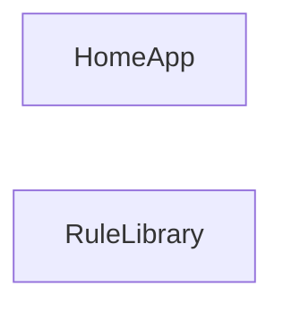

# Logical Components — u1-skeleton

Two logical parts, from `functional-spec.md`. They do not call each other. The targets they carry are NFR1.1, NFR1.2, NFR2.1, and NFR2.2.

| Component | What it owns | Failure domain | Blast radius |
| --- | --- | --- | --- |
| HomeApp | The local home route and the heading "The app is up" | The local process | The page. A failed rule check does not change it. |
| RuleLibrary | The check over markdown files under `fixtures/library` | The check's report | The report only. The page still responds when the library is empty or a file is invalid. |

There is no shared database, cache, queue, or secret. The only runtime is the local process. This phase adds no infrastructure component beyond that process.

Text fallback: HomeApp and RuleLibrary sit side by side. No arrow connects them.
