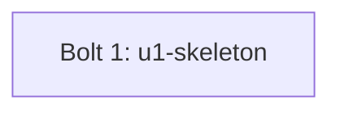

# Bolt Plan

One Bolt, meaning one build pass over a piece of the work that ends in something that runs. The piece is `u1-skeleton` (U1) from `unit-of-work.md`. `unit-of-work-dependency.md` has no second unit and no edge, so this is the only pass the graph allows.

## Bolt 1 — The local slice

This Bolt is the walking skeleton: the smallest slice that runs the whole way through, before any later game work. It is the first unit in the graph, and there is no later unit.

It includes HomeApp and RuleLibrary from `components.md`. The home page is the screen in `mockups.md`. The stories are every row in `unit-of-work-story-map.md`.

### Done when

- The app builds from a clean checkout.
- The home page responds and shows the text "The app is up", with no sign-in and no game content.
- The rule check reads `fixtures/library`. A file missing a required frontmatter field fails the check and names that file. An empty or missing library is not a failed parse, and the home page still responds.
- Tests for the check and for the home route exist, written after the code they cover.
- Nothing is deployed. Staging and production are out of this phase, per `requirements.md`.

### What shipping it proves

A developer on this repo can build the app, open the home page, and see a bad rule file fail the check without changing that page.

### What you will see

Start the app, open the home route, and read "The app is up". Run the project's tests and see the rule-check test and the home-route test pass.

### Check that proves it

No project check exists yet. The repository has no test command. The command is not chosen here. The first completion checkpoint will ask for it before it treats the slice as verified.

### How the code lands

When the code is committed, it goes on a short-lived feature branch and merges into `main` by pull request, as `team-practices.md` says. This Bolt does not deploy.

Text fallback: one box, Bolt 1, the unit u1-skeleton. No arrow.
