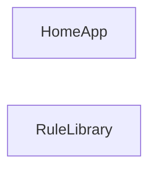

# Components

```yaml
components:
  - name: HomeApp
    summary: The TanStack Start app that shows the home page.
    behaviour: >
      Builds and runs on the developer's machine. One route, the home page,
      responds and shows the text "The app is up". The page does not fetch
      data, does not ask anyone to sign in, and does not show gameplay, an
      account, a score, or saved progress. It does not read rule files and
      it does not call RuleLibrary.
    responsibilities:
      - Serve the home page
      - Keep the page free of game content, accounts, and data fetching
    depends_on: []
    dependents: []
    entities: []
  - name: RuleLibrary
    summary: The check over the Markdown architecture-rule files.
    behaviour: >
      Reads only the Markdown files at fixtures/library. Each file is one
      rule, identified by its filename. A rule is valid when its frontmatter
      includes tags, applicable_stages, and applicable_agents, and its prose
      body states the rule, why it exists, and a short example. No heading
      set is required. A file missing any of those three fields is invalid:
      the check fails and names that file. Frontmatter that cannot be read
      fails the check and names that file. An empty fixtures/library, or a
      missing fixtures/library directory, is not a failed parse: the check
      reports that there are no rule files. This component does not render
      the home page and it does not call HomeApp.
    responsibilities:
      - Own the rule files and the check that reads them
      - Tell a failed check from an empty library
    depends_on: []
    dependents: []
    entities:
      - name: Rule
        identifier: filename
        attributes:
          - tags
          - applicable_stages
          - applicable_agents
          - body
```

## Component Diagram



Text fallback: HomeApp and RuleLibrary sit side by side. There is no arrow. Neither calls the other.

## Component Summary

| Component | Purpose | Depends On | Dependents | Entities Owned |
|---|---|---|---|---|
| HomeApp | Show the home page on the local app | none | none | none |
| RuleLibrary | Check the rule files under fixtures/library | none | none | Rule |

## Entity Ownership

| Entity | Owning Component | Identifier | Attributes | References |
|---|---|---|---|---|
| Rule | RuleLibrary | filename | tags, applicable_stages, applicable_agents, body | none |

HomeApp owns no entity. The heading on the home page is fixed copy, not a stored record.

## External Dependencies

| Component | Dependency | Kind | Purpose |
|---|---|---|---|
| none | none | none | Neither component calls a database, cache, queue, or third-party API |

The rule files are Markdown in the repo. They are the Rule records, not a service.

## Rationale

| Component | Why it is separate |
|---|---|
| HomeApp | It has its own lifecycle: build the app and answer the home route. It owns no rule data. |
| RuleLibrary | It owns the rule files and the check. It changes when a rule or the check changes, not when the home-page copy changes. |

The two do not call each other because the home page must not read the rule files, and a failed check must not change the page. This comes from `requirements.md` and `stories.md`.

### Alternatives Rejected

One block that owns both the home page and the rule-file check. That matches a single thin slice, and it was the other option. It was rejected because the page and the check do not share data or a call, so a change to one would have no reason to move the other.
