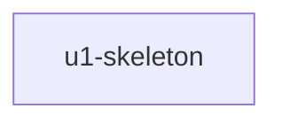

# Unit Dependencies

Topology only. This file does not choose what to build first.

```yaml
units:
  - name: u1-skeleton
    depends_on: []
```

## Diagram



Text fallback: one unit, u1-skeleton. No arrow. Nothing depends on it, and it depends on nothing.

## Integrated slice

`u1-skeleton` is the only unit, so it is the first unit in the graph. It can run on its own: the app builds, the home page responds, and the rule check reads `fixtures/library`. There is no later unit it has to wait for. The two building blocks inside it do not call each other. That boundary is in `components.md` and `decisions.md`.

## Integration points

None. There is no second unit, so there is no API, shared record, or event between units.

## Units that do not depend on each other

There is one unit. Nothing can be built beside it.
