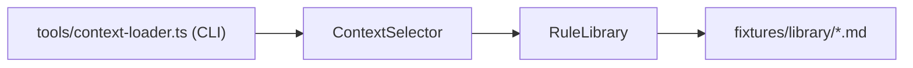

# Component Catalogue

## Upstream inputs

- `requirements` — `aidlc/spaces/default/intents/261121-context-loader/inception/requirements-analysis/requirements.md`
- `architecture` — `aidlc/spaces/default/codekb/game/architecture.md`
- `component-inventory` — `aidlc/spaces/default/codekb/game/component-inventory.md`
- Answers in `domain-design-questions.md` (Q1–Q4)

```yaml
components:
  - name: RuleLibrary
    summary: Load and parse fixtures/library Markdown rules with fail-fast frontmatter validation.
    behaviour: >
      Lists *.md under the configured library directory, parses YAML frontmatter
      for tags, applicable_stages, and applicable_agents (scalar or list → set after trim),
      and fails hard (non-zero exit, stderr naming the file) on unreadable or missing
      required fields. Does not select or rank. May reuse concepts from existing
      src/lib/rule-check.ts but owns the typed RuleDocument shape the selector needs.
    responsibilities:
      - Own RuleDocument entity lifecycle (load from disk → validated in-memory docs)
      - Fail-fast on malformed frontmatter (FR2.1)
    depends_on: []
    dependents:
      - component: ContextSelector
        interaction: Supplies validated RuleDocument list for matching and ranking
    external_dependencies:
      - name: fixtures/library
        kind: other
        purpose: Local Markdown rule library on disk
      - name: Node.js fs
        kind: other
        purpose: Directory listing and file reads
    entities:
      - name: RuleDocument
        identifier: filename
        attributes: [filename, path, tags, applicableStages, applicableAgents, body]
        references: []

  - name: ContextSelector
    summary: Match, rank, cap, and emit compact JSON selection; owns the CLI entrypoint.
    behaviour: >
      Accepts --stage, --agent, --tags (omit = unconstrained). Candidate set uses OR
      across provided dimensions (FR1.2). Stage/agent match is case-sensitive prefix:
      the request value (trimmed) is a prefix of an entry in the frontmatter set
      (domain-Q2). Tags match when at least one requested tag equals a rule tag
      (exact, trimmed). Score = count of matching dimensions; ties by ascending
      filename; take top 4. Always write JSON to stdout (paths/ids, frontmatter
      summary, compact index <3 KB). Under-floor (<2) still writes JSON and warns
      on stderr but exits 0 (FR1.5 revised). Hard failures (parse/IO) exit non-zero.
      Exit 0 when selection completes without hard failure (≥2 or under-floor).
      Thin CLI lives here (tools/context-loader.ts entry).
    responsibilities:
      - Own SelectionResult entity (ordered picks + index + exit semantics)
      - OR filtering, dimension scoring, filename tie-break, cap at 4
      - JSON stdout / stderr diagnostics / process exit codes
      - Enforce <5 ms selection and 0-token / no vector DB constraints in design intent
    depends_on:
      - component: RuleLibrary
        interaction: Loads validated RuleDocuments before filtering
        style: sync
    dependents: []
    external_dependencies: []
    entities:
      - name: SelectionResult
        identifier: requestKey
        attributes: [requestKey, selected, index, matchCount, underFloor, warnings]
        references:
          - entity: RuleDocument
            owned_by: RuleLibrary
            relationship: selected references zero to four RuleDocuments by filename/path
```

## Component Diagram



Text fallback: CLI invokes ContextSelector, which calls RuleLibrary to load rules from fixtures/library, then matches, ranks, and prints JSON.

## Component Summary

| Component | Purpose | Depends On | Dependents | Entities Owned |
|---|---|---|---|---|
| RuleLibrary | Load/parse/fail-fast frontmatter | — | ContextSelector | RuleDocument |
| ContextSelector | Match/rank/index + CLI | RuleLibrary | — | SelectionResult |

## Entity Ownership

| Entity | Owning Component | Identifier | Attributes | References |
|---|---|---|---|---|
| RuleDocument | RuleLibrary | filename | filename, path, tags, applicableStages, applicableAgents, body | — |
| SelectionResult | ContextSelector | requestKey | requestKey, selected, index, matchCount, underFloor, warnings | RuleDocument (RuleLibrary) |

## External Dependencies

| Component | Dependency | Kind | Purpose |
|---|---|---|---|
| RuleLibrary | fixtures/library | other | Rule Markdown sources |
| RuleLibrary | Node.js fs | other | Read library files |

## Rationale

| Component | Why separate |
|---|---|
| RuleLibrary | Distinct data ownership (RuleDocument) and fail-fast parse concern; change rate tied to frontmatter/library shape; aligns with existing `rule-check` inventory without folding selection into it |
| ContextSelector | Distinct selection/ranking/CLI concern and SelectionResult ownership; changes with filter/ranking policy without reopening parse rules |

**Chosen decomposition:** Two components (domain-Q1 option B).

**Alternatives Rejected:** Single `ContextLoader` (smaller but mixes parse fail-fast with ranking/CLI); three-way split with separate Cli façade (extra boundary with no distinct entity for this bugfix).
