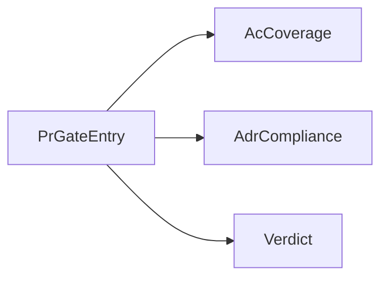

# Components

## Upstream inputs

- `requirements` — `aidlc/spaces/default/intents/261122-pr-gate-plugin/inception/requirements-analysis/requirements.md`
- `architecture` — `aidlc/spaces/default/codekb/game/architecture.md`
- `component-inventory` — `aidlc/spaces/default/codekb/game/component-inventory.md`
- Q1 answer B in `domain-design-questions.md`

The existing context loader, selector, and rule library in `component-inventory` stay as they are. They are not components this work writes. [requirements]

```yaml
components:
  - name: PrGateEntry
    summary: Thin entry that runs the two checks, then asks for the verdict.
    behaviour: >
      Receives the git diff and the spec.md for one run and does not search
      the repo for them. Calls AcCoverage, then AdrCompliance, then Verdict.
      Returns Verdict's JSON and Markdown unchanged. Does not apply acceptance
      criteria or architecture rules itself, and does not modify the diff or
      the spec.
    responsibilities:
      - Own the plugin package at plugins/pr-gate/ (plugin.json, scopes, stages, sensors)
      - Own the call order for one check run
    depends_on:
      - component: AcCoverage
        interaction: Run the acceptance-criteria check first and take its result
        style: sync
      - component: AdrCompliance
        interaction: Run the ADR check second and take its result
        style: sync
      - component: Verdict
        interaction: Build the verdict from both results
        style: sync
    dependents: []
    entities: []
  - name: AcCoverage
    summary: Decide whether the diff's test change covers the spec's acceptance-criterion ids.
    behaviour: >
      Collect every AC-<positive integer> id in the given spec. An automated
      test is a diff path ending in .test.ts, .test.tsx, or .spec.ts that is
      added or whose content changes. A deletion-only change does not count.
      When at least one id exists and no such test change exists, every id is
      uncovered and the result blocks. When at least one such test change
      exists, every id is covered. When no id exists, the check passes.
    responsibilities:
      - Own the acceptance-criteria match rule
      - Own which diff paths count as automated tests
    depends_on: []
    dependents:
      - component: PrGateEntry
        interaction: Asks for the acceptance-criteria result first
    entities:
      - name: AcceptanceCriterion
        identifier: id
        attributes: [id, covered]
  - name: AdrCompliance
    summary: Judge the diff against only the rules the context loader returns.
    behaviour: >
      Call the existing context loader. Do not modify the loader or
      fixtures/library. For each returned rule, apply a block only when that
      rule's own text states a constraint the diff can break, and then report
      the file and line. When the text states no such constraint, record the
      rule as not checked and do not block for it. Ignore rules the loader
      did not return, including the challenge examples unless a returned rule
      states them.
    responsibilities:
      - Own the call to the existing context loader
      - Own which returned rules block and which are not checked
    depends_on: []
    dependents:
      - component: PrGateEntry
        interaction: Asks for the ADR result second
    external_dependencies:
      - name: context-loader
        kind: other
        purpose: Return the rules for this run. The loader is existing code, not a component we write.
    entities:
      - name: RuleCheck
        identifier: rulePath
        attributes: [rulePath, outcome, file, line]
  - name: Verdict
    summary: Emit one JSON verdict and one Markdown verdict, and say whether the gate blocks.
    behaviour: >
      Take the acceptance-criteria result and the ADR result. blocking is true
      when any acceptance criterion is uncovered or any returned rule is
      violated. A not-checked rule does not make blocking true. The JSON and
      the Markdown list the same findings. An acceptance-criteria miss names
      the id and spec.md. A rule violation names the file and line.
    responsibilities:
      - Own the blocking flag
      - Own the JSON and Markdown text of one run
    depends_on: []
    dependents:
      - component: PrGateEntry
        interaction: Asks for the combined verdict last
    entities:
      - name: GateVerdict
        identifier: inputs
        attributes: [blocking, findings, notChecked]
        references:
          - entity: AcceptanceCriterion
            owned_by: AcCoverage
            relationship: The verdict lists the acceptance criteria from that check
          - entity: RuleCheck
            owned_by: AdrCompliance
            relationship: The verdict lists the rule checks from that check
```

## Component Diagram



<!-- Text fallback: PrGateEntry calls AcCoverage, then AdrCompliance, then Verdict. The three checks do not call each other. The context loader is outside this graph. -->

## Component Summary

| Component | Purpose | Depends On | Dependents | Entities Owned |
|---|---|---|---|---|
| PrGateEntry | Run the checks in order and return the verdict | AcCoverage, AdrCompliance, Verdict | None | None |
| AcCoverage | Match acceptance-criterion ids to a test change in the diff | None | PrGateEntry | AcceptanceCriterion |
| AdrCompliance | Check the diff against rules the loader returns | None | PrGateEntry | RuleCheck |
| Verdict | Write JSON and Markdown and set blocking | None | PrGateEntry | GateVerdict |

## Entity Ownership

| Entity | Owning Component | Identifier | Attributes | References |
|---|---|---|---|---|
| AcceptanceCriterion | AcCoverage | id | id, covered | None |
| RuleCheck | AdrCompliance | rulePath | rulePath, outcome, file, line | None |
| GateVerdict | Verdict | inputs | blocking, findings, notChecked | AcceptanceCriterion (AcCoverage), RuleCheck (AdrCompliance) |

## External Dependencies

| Component | Dependency | Kind | Purpose |
|---|---|---|---|
| AdrCompliance | context-loader | other | Return the rules for this run. Existing code, not a new component. |

## Rationale

| Component | Why it is separate |
|---|---|
| PrGateEntry | The chosen option's thin entry. It owns the package and the call order, and no check rule. |
| AcCoverage | The acceptance-criteria rule changes on its own and owns the test-file match. |
| AdrCompliance | The rule check changes on its own and is the only block that calls the loader. |
| Verdict | The JSON, Markdown, and blocking flag are one result with one lifecycle. |

Option B in `domain-design-questions.md` is the decomposition. One component, and a split that keeps both checks together, were the other viable shapes. They are recorded in `decisions.md`. The context loader, the home route, and `src/lib/rule-check.ts` from `architecture` and `component-inventory` are not building blocks of this plugin.
